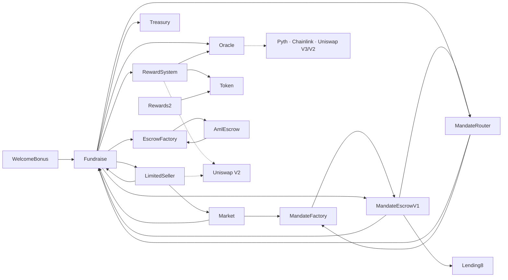
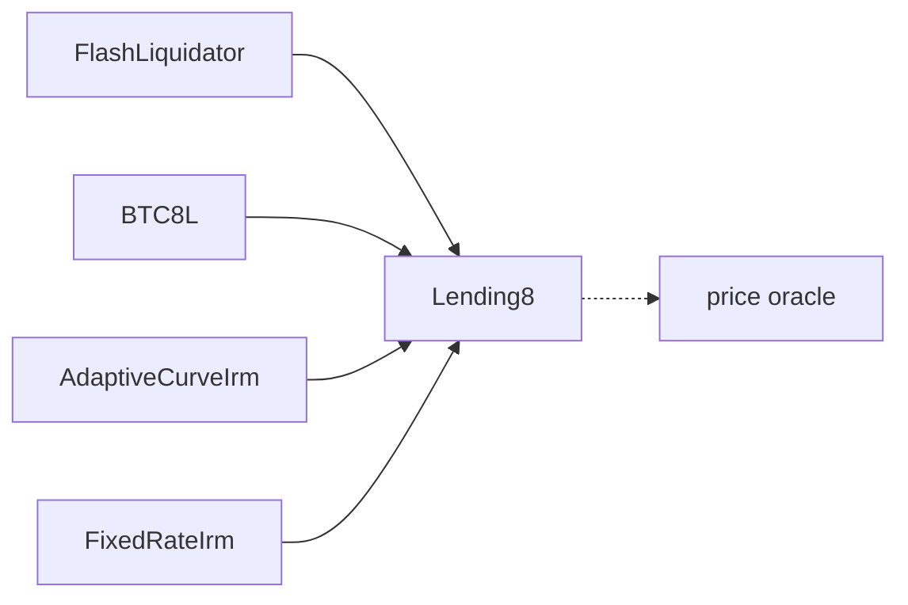

# Contracts

Map of this tree. For how to build, test and deploy, see the [root README](../README.md).

| Folder | Holds | Files |
|---|---|---|
| `core/` | The protocol: fundraising, rewards, access control, secondary market | 8 |
| `mandate/` | Auto-reinvest: the per-user escrow, its factory, the payout router | 7 |
| `bonus/` | Five one-off campaigns and Easy Start, one file each, independent of each other | 6 |
| `token/` | `Token` (8LNDS) and `BTC8L` | 2 |
| `escrow/` | Per-user escrow for AML-gated investments, and its factory | 2 |
| `oracle/` | Price feed with source priority and deviation checks | 3 |
| `lending/` | Lending market — a vendored Morpho fork, see below | 29 |
| `interfaces/` | All shared interfaces, grouped by origin | 25 |
| `mocks/` | Test doubles. Never deployed | 12 |
| `test-tokens/` | USDC/WBTC/WETH stand-ins, deployed on Sepolia only | 4 |

Folders exist per contract only where they earn it: `core/market/` because `Market.md`
sits beside the contract, `token/8lnds/` because the folder name is what says which token
`Token.sol` is. Everything else is flat.

`mandate/` keeps its own `interfaces/`: the escrow is a clone with no upgrade path, so its ABI is
frozen per version, and mixing those declarations with the upgradeable ones would blur that.

Routing is per owner and per project: `routes[owner][pid]` names the escrow that project's money
goes to, the owner sets it with `setRoute` and detaches with `clearRoute`, and a frozen owner cannot
detach — that is the one exception, because detaching would point the payouts back at the wallet the
freeze exists to protect. `Fundraise` asks the router on every path that moves a position's money,
so an unrouted project simply pays the wallet as before. `clearIfEmpty` exists so a route left over
from a finished project can be tidied without the owner coming back for it.

## How they fit together

Fundraising and rewards. Arrows point from caller to callee:



`Fundraise` is the hub: it records investments, asks `Oracle` for the platform-token price,
tells `RewardSystem` what to accrue, sends the platform fee to `Treasury`, and routes
AML-gated investments through an escrow. `Market` and `LimitedSeller` call back into it to move
positions and to read how much a user invested.

Lending is a separate subsystem, reached by address rather than by import:



`ManagerRegistry` is left out of both diagrams on purpose: sixteen contracts consult it — five in
`core` (`Fundraise`, `RewardSystem`, `Rewards2`, `LimitedSeller`, `Market`), all six in `bonus/`,
all three in `mandate/`, plus `EscrowFactory` and `Token` — and an arrow from each would bury
everything else.

**The registry stands on the payout path, not beside it.** `requirePayoutAllowed` is not a
view: it stands between a paying contract and the user's money, and it refuses by reverting. Anyone
tracing a payout path has to go through the registry, whatever the diagrams suggest.

## Chains, freeze and the payout gate

Three mechanisms live in `ManagerRegistry` that almost every paying contract touches and none of
which is obvious from the method names.

**The recovery chain** points a compromised wallet at its replacement. Four methods read it:

| Method | Answers |
|---|---|
| `canonicalOf[addr]` | the raw mapping: the head this address was filed under, or zero |
| `headOf(addr)` | where state lives — the head for a superseded wallet, the address itself otherwise |
| `recipientOf(addr)` | where money goes — the head's claim address if set, else the head |
| `isCompromised(addr)` | whether this address was superseded, i.e. `recipientOf(addr) != addr` |

The chain is flat: `headOf` is one hop, never a walk, and for `A -> B -> C` every one of the three
resolves to `C`. `isCompromised` is true for `A` and `B` and false for `C` — deliberately, since
flagging `C` would lock the user out of the market. State about a user is filed under the head, so a
contract that stores anything per user keys it by `headOf` and pays by `recipientOf`.

**The freeze** is a panic button, not a verdict. `freeze` may be pressed by support, by an operator
or by the user himself — one signature, no recovery address named, because the backend may spot a
theft before support reads the ticket and because a user whose claims the operator pays for holds no
ETH to press his own. `freezeMany` takes up to 200 addresses and is support or operator only.
Lifting is narrower: `unfreeze` is support only and one address at a time.

A freeze does not expire: `_freeze` writes `type(uint64).max` into `frozenUntil`. `isFrozen` is
what callers should ask.

**The payout gate** is the extension point for a second factor:

```solidity
function requirePayoutAllowed(
    bytes32 _action, address _user, address _token,
    uint256 _amount, bytes32 _context, bytes calldata _auth
) external;
```

`_user` is whose rules are read — the person being protected, not the caller. `_amount` is
`type(uint256).max` when the figure is only known at execution and the user could not have signed
it. `_auth` is parsed here, never by the caller, and is empty while no factor is required. The
function is non-view on purpose: a second factor will need to burn a nonce, and making it a view
later would be a breaking change.

**Its selector is permanent.** Mandate clones are immutable and will call it forever; removing or
renaming it stops withdrawals from every mandate at once.

## Deployment model

Most of the protocol is UUPS-upgradeable behind an ERC-1967 proxy. On production the owner is
a Gnosis Safe, so upgrades go through a prepared batch rather than a direct call.

Four are not upgradeable, each for its own reason:

- `Token` — a plain `ERC20, Ownable`. Deliberate: the platform token's rules are fixed.
- `AdaptiveCurveIrm`, `FixedRateIrm` — interest rate models, deployed plain and swapped by
  enabling a new address on the market. Each keeps per-market rate state, so a swap starts that
  state from scratch rather than carrying it over.
- `AmlEscrow` — deployed as an EIP-1167 minimal clone by `EscrowFactory`, one per user, with
  `initialize()` instead of a constructor. Addresses are `CREATE2`-deterministic and depend on
  the implementation address, not on where its source lives.

`TreasuryLending` is `contract TreasuryLending is Treasury {}` — an empty subclass, deployed
separately so lending fees sit in their own contract with their own owner.

## Interfaces

Split by who controls the shape:

- `protocol/` — our contracts. These must stay in step with the deployed ABI; a signature that
  drifts here compiles fine and reverts on chain.
- `external/` — third-party ABIs (Uniswap, Chainlink, Pyth). Not ours to change.
- `token/` — ERC-20 and its extensions.

One interface per contract, holding everything its consumers need. Earlier each consumer kept
its own narrow copy; `IManagerRegistry` alone existed in ten copies across four versions, one
of which declared a function `ManagerRegistry` does not have. Unused declarations cost nothing
— an `interface` emits no code, only the selectors actually called end up in the bytecode.

`lending/` and `mocks/` keep their own copies on purpose: the first to stay syncable with
upstream, the second because it is test-only.

## lending/

A fork of Morpho Blue, vendored rather than imported. Treat it as upstream code: it is worth
keeping diffable against Morpho, so resist reformatting, renaming or moving files around inside
it. Its interfaces and libraries stay local for the same reason.

`FlashLiquidator` is ours, built on top of it: liquidation funded by a Lending8 flash loan when
a Uniswap pair exists, from the contract's own balance otherwise, falling back to direct
liquidation if the swap fails so an empty pair cannot block liquidations.
